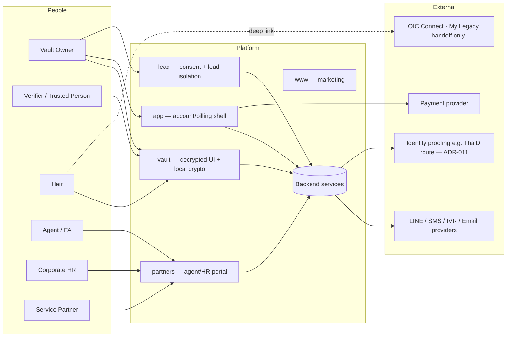
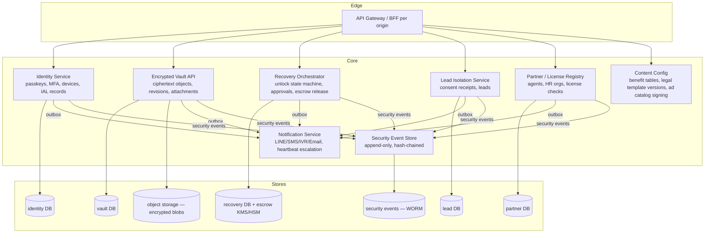
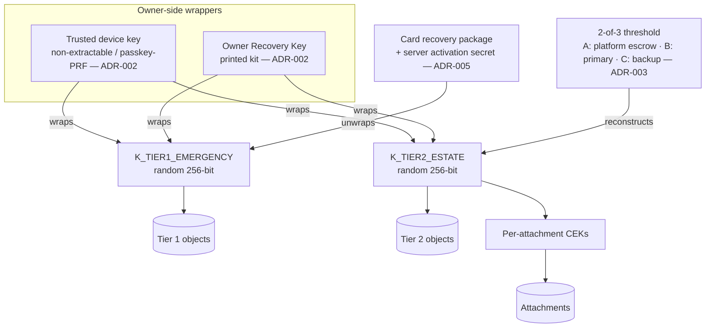
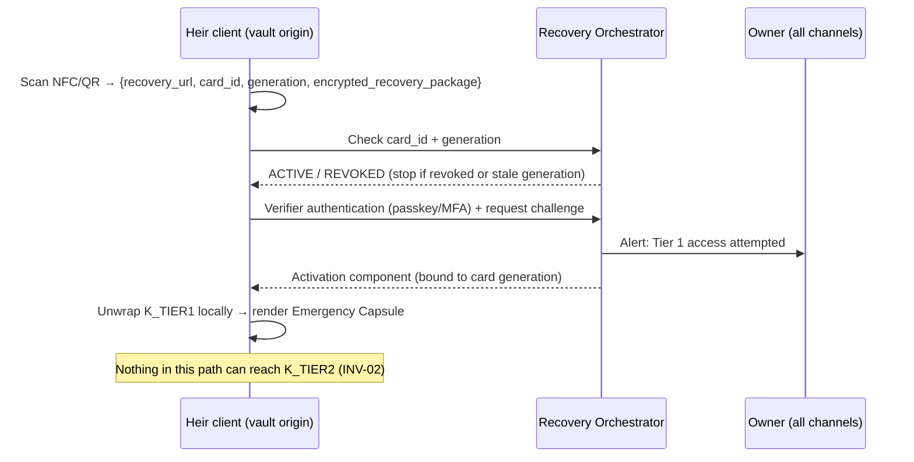
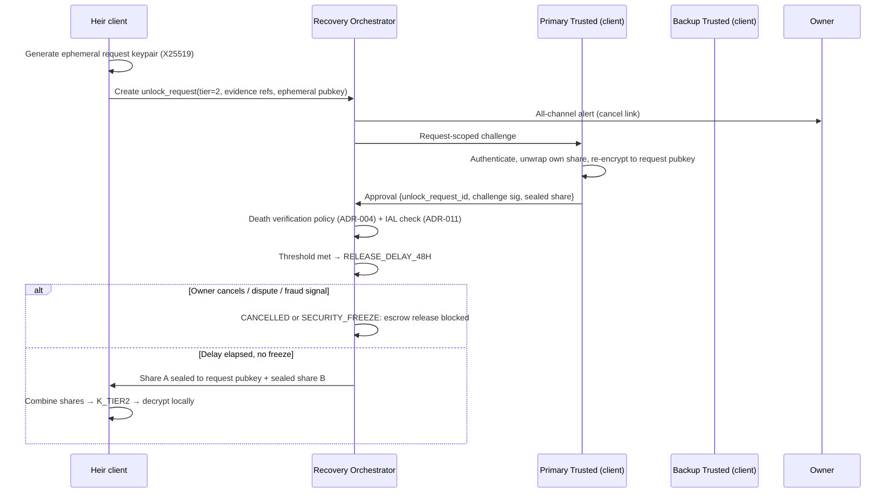

# Architecture

> **Status:** Draft. Derived from PRD v1.1.1 §5–§7. Items marked **(ADR-xxx)** are
> still open, and the text gives the PRD default position or a proposal. Don't
> build against a proposal until its ADR is *Accepted*.

## 1. Goals that shape the architecture

1. **Cryptographic authorization equals product authorization.** If the UI says "Tier 1 only", the key material must make Tier 2 undecryptable.
2. **Server sees ciphertext, wrapped keys and minimal metadata.** All semantic work (rendering, coverage gap, ad-rule matching, conflict resolution) runs on a trusted client.
3. **No single party can recover Tier 2.** That includes the platform, any partner, support, an agent or one verifier.
4. **Every recovery path can be revoked and rotated** before an incident happens.
5. **Survives the company.** Exported bundles stay recoverable with documented formats and an independent tool.
6. **Data domains are physically separated.** Vault, lead, partner, analytics and security events don't share tables or DB roles.

## 2. System context



## 3. Origins (PRD §5.1)

Each origin is its **own build, deployment, cookie scope and service worker**.

| Origin | App | Trust level | Rules |
|---|---|---|---|
| `www.` | `apps/web-marketing` | Public | May use marketing analytics. Never links scripts into other origins |
| `app.` | `apps/web-app` | Authenticated, no plaintext | Account, billing, onboarding shell. No vault keys in memory |
| `vault.` | `apps/web-vault` | **Highest**: plaintext + keys in memory | First-party JS only, strict CSP (`script-src` by hash), Trusted Types, `connect-src` allow-list, no inline JS, no remote error reporters, no session replay |
| `partners.` | `apps/web-partners` | Partner-authenticated | Relationship metadata only. No vault API scopes |
| `lead.` | `apps/web-lead` | Consent domain | Consent capture, lead submission. No vault session cookies |

Navigation from `vault` to other origins uses top-level links only, never `postMessage` with
sensitive data. Payloads handed from `vault` to `lead` (for example the gap bracket) cross over
only as **user-reviewed, minimum fields** on the consent screen (FR-2.3).

## 4. Backend services (logical)



| Service | Owns | Never holds |
|---|---|---|
| Identity | Accounts, passkeys/MFA credentials, trusted devices, verifier IAL records | Tier keys, vault plaintext |
| Encrypted Vault API | Envelopes, revision lineage, attachment manifests, provenance metadata | Unwrapped keys, plaintext |
| Recovery Orchestrator | `unlock_requests`, approvals, disputes, release delay timers, **Share A escrow** (wrapped by KMS/HSM) | Shares B/C in usable form, `K_TIER2` |
| Notification | Delivery state, escalation schedules | Content beyond templates + opaque refs |
| Lead Isolation | Consent receipts, leads, partner assignment | `user_id`, `vault_id` |
| Partner/License Registry | Agent/HR/partner profiles, `last_verified_at` | Any vault data |
| Security Event Store | Append-only events | Sensitive plaintext |
| Content Config | Benefit tables, legal template versions, signed ad catalog | User data |

**Inter-service messaging:** a transactional **outbox** in each service DB, relayed to the
Notification Service and the Security Event Store. Outbox payloads carry IDs and event types
only. If scale ever needs it, the relay can become CDC (e.g., Debezium → Kafka) without
changing producers. No vault-derived payloads ever go on a shared bus.

## 5. Client-side key hierarchy (PRD §5.2)



- `K_TIER1` and `K_TIER2` are **independently random**. Neither is derived from the other or from a common master. (The v1.0 "MVK" is gone.)
- The owner's wrappers may wrap both keys. **Post-death recovery paths each wrap exactly one.**
- Delegated access (FR-4.7) gets a separate wrapper over a **Tier 1 subset** key and never touches `K_TIER2`.
- Key rotation bumps `key_version`, re-encrypts or re-wraps, and keeps the object's logical identity stable.

## 6. Encryption envelope (PRD §5.3, ADR-001)

```text
Envelope v1 (conceptual, canonical binary encoding TBD in ADR-001)
  crypto_version : u16
  cipher_suite   : enum { XCHACHA20_POLY1305 | AES_256_GCM }
  key_version    : u32
  aad_version    : u16
  nonce          : 24 B (XChaCha) | 12 B (GCM): fresh CSPRNG per encryption
  ciphertext+tag : bytes

AAD v1 = canonical_encode(vault_id, logical_object_id, tier, object_type,
                          schema_version, key_version, object_revision)
```

- **Proposal:** XChaCha20-Poly1305, because random 192-bit nonces remove the GCM nonce-collision budget concern for multi-device clients. It must run on RustCrypto in WASM. Decide in ADR-001.
- Attachments: a per-file CEK wrapped by the Tier key, chunked AEAD (STREAM construction) for streaming decrypt (NFR-PERF-01).
- Including `object_revision` in the AAD is a **proposal** for rollback detection (ADR-013).

## 7. Recovery flows

### 7.1 Tier 1: emergency card (FR-4.1 Path B, ADR-005)



Proposed construction: `package = AEAD(K_card, K_TIER1)` where `K_card = HKDF(card_secret ‖ activation_secret_gen)`.
The card alone, or the server alone, can't open it. Revoking deletes `activation_secret_gen`.
A photographed old card plus a server compromise is the residual risk, which is why rotation is recommended on loss (FR-5.1).

### 7.2 Tier 2: threshold + death verification + release delay (FR-4.3, ADR-003/004)



- Shares are **sealed to the request's ephemeral key**, so approvals and shares can't be replayed into a different request (INV-06).
- **The server never combines shares**, so the server never sees `K_TIER2`.
- ⚠️ **Open topology issue:** with plain 2-of-3, **B + C together** can reconstruct without Share A. That bypasses death verification, release delay, owner cancellation and freeze. See [REVIEW-NOTES §R-01](architecture/REVIEW-NOTES.md). This must be decided in ADR-003.

### 7.3 Owner device and account recovery (FR-1.6, ADR-002)

The owner uses the **owner-held recovery kit** (high-entropy recovery key) on a new device, and the
client unwraps the Tier keys locally. Then the client enrolls the device, revokes or quarantines the
lost device, re-wraps the keys, and optionally rotates them. Support can route identity workflows but
never receives recovery material. Losing every device **and** the recovery kit means losing access.
That is an explicit product trade-off and must be communicated during onboarding.

## 8. Vault and unlock state machine (PRD §7)

See [architecture/STATE-MACHINES.md](architecture/STATE-MACHINES.md) for the full diagrams and
transition tables. Key properties:

- Heartbeat states only escalate notifications.
- `RELEASE_DELAY_48H` requires the threshold first.
- `SECURITY_FREEZE` is non-terminal and timer-immune.
- Terminal request states: `COMPLETED | CANCELLED | EXPIRED | REJECTED`. Approvals die with their request.

The orchestrator should be built as an **explicit, persisted state machine** (table + transition log,
with optimistic locking on `status`). Model-based tests come from the transition table.

## 9. Sync, devices and rollback (PRD §5.8, ADR-013)

- Each write carries `logical_object_id`, `object_revision`, `parent_revision` and `writer_device_id`.
- The server enforces **compare-and-swap** on `(logical_object_id, parent_revision)` and rejects stale writes with a conflict. It never merges plaintext.
- Clients show a conflict UX for security-sensitive types (will, verifier set, recovery policy, beneficiary status).
- Optional hardening: the owner signs a **vault head** (a hash over current revisions) so a malicious server can't serve an older but valid set (rollback by omission).

## 10. Data domains

| Domain | Store | Linkable to vault? |
|---|---|---|
| Identity | identity DB | Yes, owns `user_id` |
| Vault ciphertext | vault DB + object storage | Yes |
| Recovery | recovery DB + KMS/HSM for escrow wrapping | Yes, `vault_id` |
| Lead | lead DB (separate role/credentials) | **No.** Only a consent receipt/one-time token with retention limits |
| Partner CRM | partner DB | Relationship rows only (agent ↔ user invite status) |
| Product analytics | analytics store | Opaque, allow-listed events only |
| Security events | WORM/append-only store | `vault_id` + hashed actor refs |

Logical schema: [architecture/DATA-MODEL.md](architecture/DATA-MODEL.md).

## 11. Client-side engines

- **Risk engine** (`crates/risk-engine` → WASM): coverage gap = `(liabilities + family living cost) − (liquid assets + life/MRTA cover)`, using versioned formulas and assumptions (FR-2.1). The only output that may leave the device is a coarse bucket, and only with consent.
- **Ad matcher:** the client downloads a **signed** static ad catalog with expiry and evaluates rules locally. The server learns about a match only when the user clicks a CTA (FR-2.2).
- **Readiness/freshness score:** computed on the client. Telemetry gets `CURRENT/STALE/UNKNOWN` counts only.

## 12. Supply chain and delivery (PRD §5.6)

- Pinned dependencies, committed lockfiles, reviewed lockfile diffs, SBOM (CycloneDX) per release, vulnerability scanning.
- Reproducible or verifiable `web-vault` builds. Signed release manifest (e.g., Sigstore) listing asset hashes.
- CSP + Trusted Types enforced. CI fails on new `connect-src` or `script-src` entries without review (AC-07).
- Option, ADR-006: a signed native/PWA companion for higher assurance, because web delivery can't fully remove the malicious-build risk.

## 13. Observability

- Ops telemetry: latency, error codes, browser family, `crypto_version`, object-count buckets.
- Product analytics: **allow-listed event schemas**. The server rejects unknown fields.
- Security events are separate from growth analytics, with their own retention.
- No DOM capture, session replay or plaintext stack traces from the vault origin.

## 14. Portable recovery and service exit (FR-5.3, ADR-012)

The export bundle contains encrypted objects, an attachment manifest, a crypto/version manifest,
recovery metadata, a card/verifier generation summary and human-readable instructions. The format is
documented in-repo, and `crates/recovery-cli` (native, no network) validates and recovers it. The
service-exit runbook covers the notice period, the export window, escrow handling (see R-01) and deletion.

## 15. Proposed technology mapping

See [ADR-016](adr/ADR-016-implementation-stack.md) (Proposed) and [ADR-017](adr/ADR-017-monorepo-layout.md).
