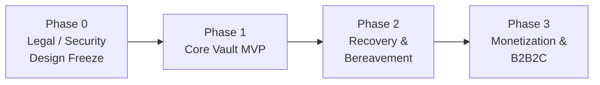

# Roadmap

Based on PRD §12. Each phase has **exit criteria**, and the next phase doesn't start
until they're met. Dates are left blank on purpose. Set them once team capacity is known.

## Phase 0: Legal/Security Design Freeze ← *current*

**Goal:** decide everything that is expensive to change later (crypto format, key
hierarchy, recovery topology, legal copy) before production code exists.

| # | Deliverable | Output | Refs |
|---|---|---|---|
| 0.1 | Thai counsel review: will templates (§1656/§1657 + §1653/§1670/§25 checklist), Living Will copy, insurance lead model (incl. OIC B.E. 2569 guidelines), legal directory model, e-will validity | Counsel memo, approved template v1 | §8, R-13, R-14, R-16, R-17, R-19 |
| 0.2 | ADRs for key hierarchy, crypto library, recovery threshold, escrow release, web threat model | ADR-001, 002, 003, 005, 006 *Accepted* | §14 |
| 0.3 | Abuse-case workshop | Updated THREAT-MODEL.md | §12 |
| 0.4 | Data map, PDPA RoPA, retention model | RoPA, retention schedule, processor register | §8.1, ADR-010 |
| 0.5 | Owner/device recovery threat model + **tested** owner-held recovery prototype | Spike in `crates/vault-core` | FR-1.6, ADR-002 |
| 0.6 | Portable recovery format + minimum export contract | `docs/formats/export-bundle-v1.md` | FR-5.3, ADR-012 |
| 0.7 | Verifier IAL policy baseline + provider abstraction | ADR-011 *Accepted* | FR-1.7 |
| 0.8 | Stack + repo tooling | ADR-016/017 *Accepted*. CI skeleton (fmt, lint, test, SBOM) | — |

**Engineering spikes (allowed in Phase 0, throwaway quality, must not ship):**

- `vault-core` envelope encrypt/decrypt with AAD in Rust → WASM, with a nonce-uniqueness property test and a Tier 1 ⇏ Tier 2 negative test.
- Threshold recovery prototype for the R-01 options (a) and (b).
- `web-vault` CSP/Trusted Types skeleton with a CI check that fails on new script sources.

**Exit criteria:** ADR-001/002/003/005/006/011/012/013/016 Accepted · counsel sign-off on 0.1 ·
RoPA drafted · REVIEW-NOTES High items resolved.

## Phase 1: Core Vault MVP

| Feature | FR | Key ACs |
|---|---|---|
| Account + Passkey/MFA | FR-1.6 | NFR-SEC-03 |
| Tier 1/Tier 2 encrypted objects with separate keys | FR-4.2 | AC-01, AC-02 |
| Free tier (5 items) asset/liability/insurance mapping | FR-1.1, FR-1.2 | — |
| Will guide v1 (1657 guide, 1656 pack) + encrypted attachments | FR-1.3 | AC-09, AC-10 |
| Emergency Capsule + Living Will separation | FR-1.4 | — |
| Basic verifier invite + recovery kit (**no** automated dead-man escalation) | FR-1.5, FR-5.2 | AC-03 |
| Local coverage gap calculation (WASM) | FR-2.1 | NFR-PRIV-01 |
| Trusted-device enrollment/revocation + revision lineage | FR-1.6, FR-5.5 | AC-13, AC-14, AC-16 |
| Basic provenance metadata + freshness indicators | FR-5.6 | NFR-DATA-01 |
| Vault origin hardening | §5.6 | AC-07 |

**Exit criteria:** AC-01/02/07/09/10/13/14/16 automated and green in CI · external crypto
review of `vault-core` · pentest of the vault origin · WCAG 2.2 AA on core flows ·
P95 local decrypt/render < 2 s.

## Phase 2: Recovery & Bereavement

| Feature | FR | Key ACs |
|---|---|---|
| Physical card lifecycle/revocation | FR-5.1 | AC-05 |
| Request-scoped 2-of-3 recovery | FR-4.3 | AC-03, AC-18 |
| 48 h release delay + multi-channel owner cancellation | FR-4.3 | AC-04 |
| Heartbeat escalation (Continuity Service) | FR-4.1 | AC-04 |
| DISPUTED / SECURITY_FREEZE + runbook | FR-4.6 | AC-15 |
| Stage-based bereavement checklist | FR-4.4 | — |
| OIC My Legacy guided handoff | FR-4.5 | — |
| Benefit source/version configuration | §8.5 | AC-11 |
| Portable encrypted export + `recovery-cli` | FR-5.3 | AC-17 |
| Vault closure / crypto-erasure | FR-5.4 | AC-20 |
| Temporary delegated-access **pilot** (only after legal/security review) | FR-4.7 | AC-19 |

**Exit criteria:** state machine model tests cover every transition · recovery drill run end to
end with real channels · service-exit runbook tested · AC-12 runbook demonstration.

## Phase 3: Monetization & B2B2C

| Feature | FR | Key ACs |
|---|---|---|
| Privacy-Limited Quote + consent receipts + lead isolation | FR-2.3 | AC-08 |
| Contextual ad matching (signed catalog) | FR-2.2 | — |
| Agent portal, sticky card, license verification | FR-3.1 | AC-06 |
| Corporate HR benefit catalog + beneficiary statuses | FR-3.2 | AC-06 |
| Partner directory, billing, conversion feedback | §11 | — |

**Gate:** counsel or OIC confirmation of the lead/fee model (R-13) **before** launch, including how the OIC guidelines for unlicensed persons on digital media (B.E. 2569, in force 24 Jul 2026) apply to contextual cards, links and CPL (R-16).

## Continuous (all phases)

- Supply chain: SBOM, pinned dependencies, signed releases, dependency review.
- Annual service-exit exercise (NFR-DUR-01) and scheduled backup/restore exercises (NFR-REL-01).
- Regulatory content refresh at each release (PRD §15 Source Control).
