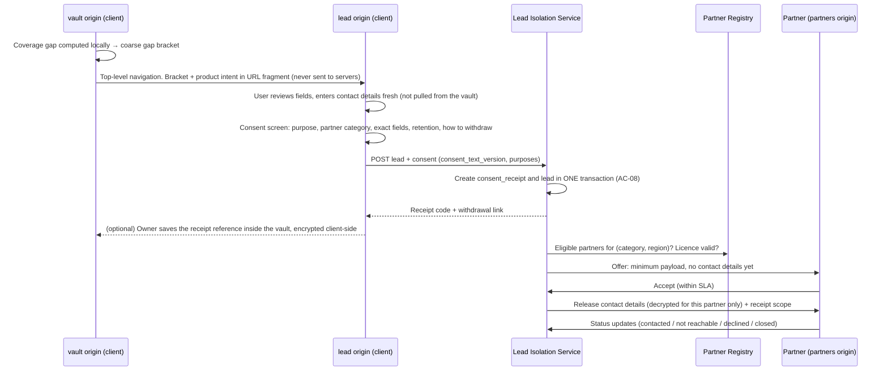
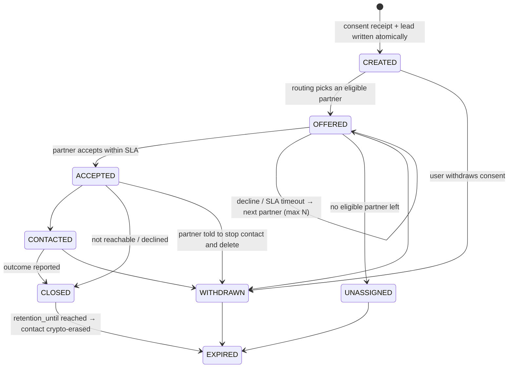
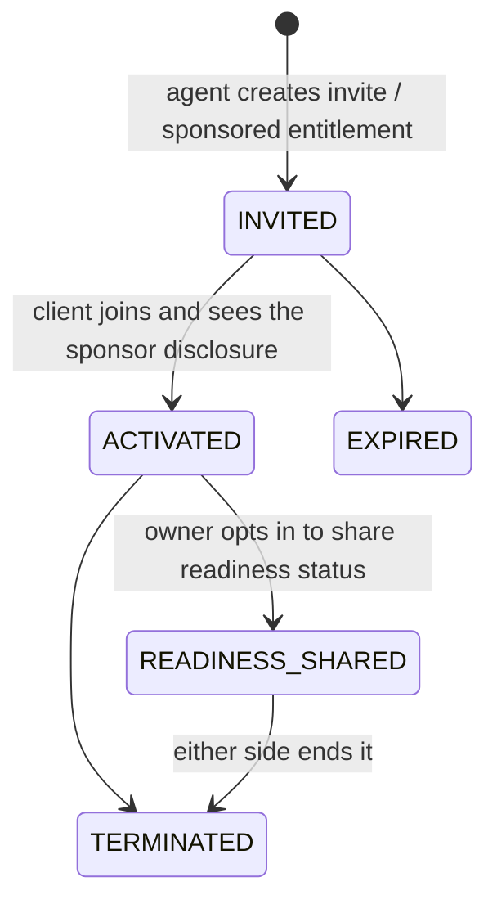

# Leads & Partners

> **Status:** Draft, from PRD v1.1.1 FR-2.2, FR-2.3, FR-3.1, FR-3.2, §6.1, §8.2, §8.3 and §11.
> Everything here is **Phase 3**, and it is gated on counsel review of the lead/fee model
> (REVIEW-NOTES R-13, R-16). Items marked *Proposal* need an ADR or counsel sign-off.

## 1. Why this needs its own design

Revenue depends on leads and partners, and so does most of the regulatory and trust risk. The
vault is zero-knowledge, but **the lead domain is not**: to route a quote request, the platform
has to process the user's contact details. PRD §2.1 forbids a "silent downgrade from
zero-knowledge claims", so the product must say this plainly on the consent screen. This domain
therefore has to stay small, isolated and auditable.

## 2. Partner types

| Partner type | What they get | Commercial model (PRD §11, hypotheses) | Licence check |
|---|---|---|---|
| **Insurance agent / FA** (Agent SaaS) | Invite links, sponsored entitlements, sticky card, relationship dashboard (metadata only) | 490–990 THB/month | OIC agent licence, `last_verified_at` |
| **Insurance lead partner** (insurer/broker) | Assigned Privacy-Limited Quote leads | Fixed fee per lead, **subject to legal confirmation** (R-16) | OIC insurer/broker licence |
| **Legal service** (probate / estate administrator) | Directory listing, user-requested contact | Fixed admin/directory/software fee. **No % of legal fees** (§8.3) | Lawyer licence / firm identity, conflict disclosures |
| **Funeral / at-need service** | Directory listing, user-requested contact, contextual card | Fixed placement/directory fee | Business registration |
| **Corporate HR** (employer) | Benefit catalog, beneficiary planning hub for employees | Per employee / annual plan | KYB + data processing agreement |
| **Contextual card advertiser** | A placement in the signed static ad catalog | Fixed placement fee (no per-impression billing, so no tracking is needed) | Depends on category. Insurance → licence + R-16 review |

No partner type, ever, gets vault plaintext, a vault API scope or a default recovery share
(INV-17, PRD §5.4).

## 3. Lead lifecycle (Privacy-Limited Quote, FR-2.3)

### 3.1 Flow



### 3.2 State machine



### 3.3 Rules

| Rule | Ref |
|---|---|
| A lead can't exist without a consent receipt created in the same transaction. The receipt stores `consent_text_version`, purposes, `granted_at`, `expires_at` and `revoked_at` | FR-2.3, AC-08 |
| Lead tables have **no `user_id`/`vault_id`**. The lead origin has its own session and never sees vault cookies | §6.1, INV-16 |
| The payload is a **minimum**: `lead_category`, `age_bracket`, `coverage_gap_bracket`, `product_intent`, region. Raw amounts never leave the vault | FR-2.1, NFR-PRIV-01 |
| Contact details are encrypted at rest with a lead-domain KMS key, and are decrypted only to release them to the **one** partner who accepted | FR-2.3 |
| Partners see contact details only **after** they accept. Before that, they see only the minimum payload | FR-2.3 "minimum necessary after assignment" |
| Routing only goes to partners whose licence is currently verified (`last_verified_at` within the cadence, ADR-009) | §8.2 |
| Withdrawal stops processing, notifies the partner to stop contact and delete, and is recorded on the receipt | FR-2.3, PDPA |
| Dedup and abuse control use a **keyed HMAC** of the normalized contact, held only in the lead domain | §6.1 |
| Retention: the contact is crypto-erased at `retention_until`. Aggregate stats are kept | NFR-COMP-01 |
| The vault never learns whether a lead converted. Users see their own history through receipt references saved in their vault, or through the receipt code | §10 |

### 3.4 Copy and regulatory constraints

- The CTA text is fixed by the PRD: **"ขอข้อเสนอโดยเปิดเผยเฉพาะข้อมูลที่จำเป็น"**. Never call it "anonymous".
- The consent screen has to say that the platform, and then the chosen partner, will process your contact details.
- No links that facilitate contract formation, no personalized suitability advice, and no performance-based pay tied to policies or premiums, pending counsel review of the OIC B.E. 2569 guidelines (R-16). Inquiries go to licensed partners or the OIC hotline 1186.
- Show the partner's licence status and `last_verified_at`. Warn if the status is expired (§8.2).

## 4. Contextual cards & directory (FR-2.2)

- Partners submit placements. The platform reviews them (copy, licence, R-16), then **signs** them into a static catalog with eligibility rules and an expiry. The signing key is offline, and its public key is pinned in the `web-vault` build (R-15).
- The client downloads the whole catalog and evaluates the rules **locally**. The server never learns which rule matched (FR-2.2).
- A CTA click goes to the lead origin (§3) or to a first-party directory page, **never** to a partner tracking URL from inside the vault origin (AC-07).
- Billing is a fixed placement fee, so no impression or match telemetry is needed.

## 5. Agent relationship portal (FR-3.1)



- The agent dashboard shows relationship status and the last touchpoint. **Readiness is computed on the client** (FR-1.5), so "readiness-complete" reaches the agent only if the owner chooses to share a coarse flag (*Proposal*, R-21).
- Sticky card: name, photo, licence number with its verified/last-checked date, phone/LINE, organization. Printing agent details on the physical card needs owner opt-in.
- An agent can be a verifier **only** by explicit owner choice, with a conflict-of-interest notice and an independent backup (FR-1.5, FR-5.2).
- Termination removes the sponsorship and the sticky card, and **never** affects vault data, recovery or entitlements the owner already holds (FR-3.1, FR-5.4).
- Sponsorships live in the partner domain (`sponsorships`, DATA-MODEL D-10), not on `users`.

## 6. Corporate HR hub (FR-3.2)

- The employer is controller (or processor) **only** for HR program data: the benefit catalog (group insurance, PVD, Social Security guidance, internal bereavement benefits) and program enrolment.
- Beneficiary planning statuses (`PREFERENCE_ONLY → … → CONFIRMED_BY_PROVIDER`) are held **in the employee's vault** by default. A status reaches the HR domain only when the employee explicitly shares it for a specific benefit (*Proposal*, R-22).
- HR never sees the will, balances, funeral preferences or medical information (FR-3.2).
- Leaving the employer ends HR program access. The personal vault and its entitlements stay (FR-5.4).

## 7. Partner onboarding & licence lifecycle

`APPLIED → KYB_REVIEW → LICENCE_VERIFIED → ACTIVE ⇄ REVERIFICATION_DUE → {SUSPENDED | OFFBOARDED}`

- Contracts include a data processing / data sharing agreement (PDPA), a deletion-on-withdrawal obligation and disclosure duties (R-16).
- When a licence lapses, routing and directory listings are suspended automatically, and the sticky card shows a warning (§8.2).
- Partner users have organization-scoped RBAC (owner/admin/agent/viewer), passkey/MFA, and audit events in the security event store.

## 8. Authorization matrix

| Resource → / Role ↓ | Vault ciphertext | Vault plaintext | Lead minimum payload | Lead contact | Relationship metadata | HR program data |
|---|---|---|---|---|---|---|
| Owner | ✅ own | ✅ client-side | ✅ own (receipt) | ✅ own | ✅ own | ✅ own enrolment |
| Agent | ❌ | ❌ | ❌ (unless also a lead partner) | ❌ | ✅ own clients | ❌ |
| Lead partner | ❌ | ❌ | ✅ offered | ✅ after accept | ❌ | ❌ |
| Legal / funeral partner | ❌ | ❌ | ✅ offered | ✅ after accept | ❌ | ❌ |
| HR admin | ❌ | ❌ | ❌ | ❌ | ❌ | ✅ own org |
| Platform support | ❌ | ❌ | ✅ for ops | 🔒 break-glass, audited | ✅ | ✅ (support scope) |

Every ❌ is an automated API authorization test (AC-06, INV-17).

## 9. Data model (lead + partner domains, proposed)

```text
lead DB (role: lead_svc, no grants to or from the vault DB)
  consent_receipts(id, receipt_code_hash, purpose_codes[], consent_text_version, locale,
                   granted_at, expires_at, revoked_at, evidence jsonb)
  privacy_limited_leads(id, consent_receipt_id FK, lead_category, age_bracket,
                        coverage_gap_bracket, product_intent, region,
                        contact_info_encrypted, contact_hmac, status,
                        assigned_partner_id, retention_until, created_at)
  lead_offers(id, lead_id, partner_id, offered_at, responded_at, response, sla_expires_at)
  lead_status_events(id, lead_id, status, actor_partner_user_id, created_at)

partner DB (role: partner_svc)
  partner_orgs(id, type, legal_name, kyb_status, status, created_at)
  partner_users(id, org_id, role, auth_ref, status)
  partner_licences(id, org_id, licence_type, licence_no, issuer, verified_source,
                   last_verified_at, expires_at, status)
  sponsorships(id, agent_org_id, agent_user_id, client_user_ref, entitlement_id,
               status, started_at, ended_at)
  agent_invites(id, agent_user_id, code_hash, expires_at, redeemed_at)
  hr_programs(id, org_id, status), hr_benefit_catalog(id, program_id, scheme, version,
              source_url, effective_date), hr_enrolments(id, program_id, employee_ref, status)
  placements(id, org_id, category, copy_version, eligibility_rule, review_status,
             catalog_version, valid_from, valid_to)
  billing_events(id, org_id, kind, ref_id, amount_thb, created_at)  -- ref_id = lead_id or placement_id
```

`client_user_ref` and `employee_ref` are partner-domain pseudonyms, not raw `users.id`, so
partner tables can't be joined to vault rows by any role (*Proposal*, R-23).

## 10. Analytics

- Conversion is measured as `lead_id` → partner status, aggregated by category and region with a minimum cell size (e.g., k ≥ 10) before anyone sees it (§10).
- Agent retention is measured as active sponsored clients per agent and returning agent usage (PRD §1.4), with no vault signals involved.
