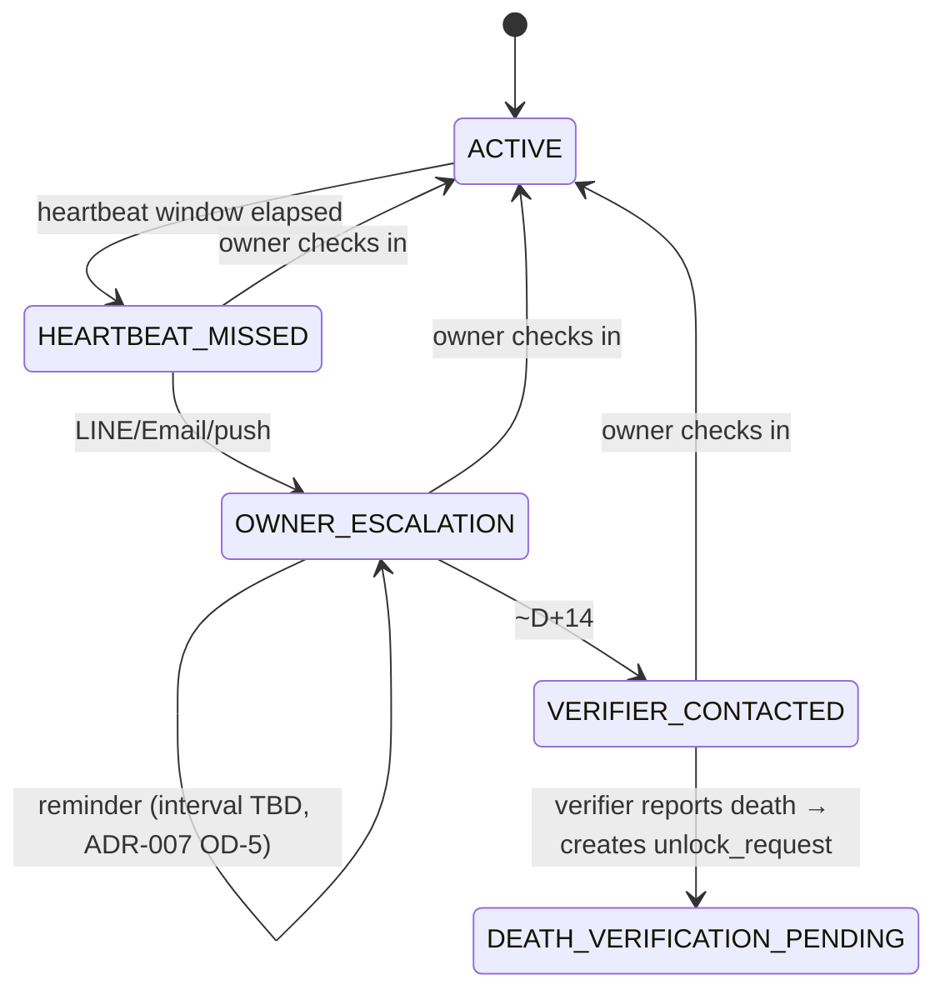
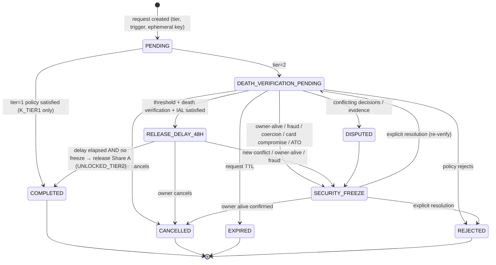
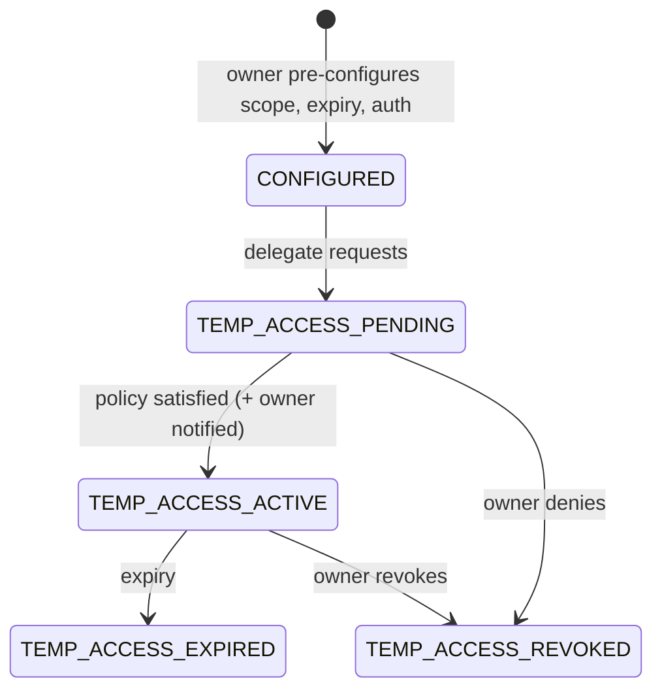
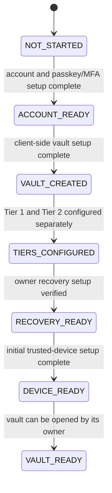

# State Machines

Derived from PRD §7, FR-4.1, FR-4.6, FR-4.7, FR-5.1, FR-5.2 and FR-3.2.

> **Design note:** PRD §7 draws a single "vault lifecycle" that mixes the **heartbeat
> lifecycle** of the vault with the **unlock request** lifecycle. They are split here
> into separate machines (see REVIEW-NOTES R-04). A vault can have one heartbeat state
> and *several* unlock requests at once, and competing requests must be correlated (FR-4.6).

## 1. Heartbeat / inactivity (per vault) — FR-4.1 Path A

**Invariant (INV-07):** no state in this machine releases recovery material. The furthest it
can go is *prompting* a verifier to open an unlock request, which then has to pass the full
Tier 2 policy. Escalation runs over LINE, Email and push; SMS and IVR are excluded. Provider
costs and quotas apply, so delivery is best-effort (FR-1.1, ADR-007). Delivery failure or silence
is neither death evidence nor approval, and it never shortens `RELEASE_DELAY_48H` (INV-07, INV-08).
Failed-alert handling is open (ADR-007 OD-4).

## 2. Unlock request (per request) — FR-4.1 Path B, FR-4.3, FR-4.6

| Rule | Ref |
|---|---|
| `RELEASE_DELAY_48H` is entered only once the threshold is satisfied | §7.1 |
| `SECURITY_FREEZE` blocks release and pauses the delay. It **never** exits on a timer | FR-4.6, AC-15 |
| Exiting `SECURITY_FREEZE` needs an explicit resolution policy, evidence review and an audit event | FR-4.6 |
| Owner cancellation invalidates the server release token and share delivery for that request | FR-4.3 |
| Approvals belong to one request and expire with it (`COMPLETED/CANCELLED/EXPIRED/REJECTED`) | FR-4.3, AC-03 |
| A card revoked after the request was created → policy: **proposed** to force re-verification and freeze if the card was reported compromised | §7.1 (open) |
| A second concurrent Tier 2 request for the same vault → correlate. Conflicting requesters → `DISPUTED` | FR-4.6 |

## 3. Temporary delegation — FR-4.7

It can't transition into, or count toward, any Tier 2 unlock (INV-15).

## 4. Physical card — FR-5.1

`ISSUED(gen n) → ACTIVE → {REVOKED | SUPERSEDED(by gen n+1) | LOST_REPORTED → REVOKED}`.
Reporting a card lost **recommends share/key rotation**. Disabling the URL alone isn't enough.

## 5. Verifier — FR-5.2

`INVITED → ACCEPTED → AUTH_SETUP → ACTIVE ⇄ REVALIDATION_DUE → {REVOKED | REPLACED}`.
Every transition is a security event. Replacing a verifier rotates their share generation.

## 6. Beneficiary status (HR hub) — FR-3.2

`PREFERENCE_ONLY → DOCUMENT_GENERATED → SUBMISSION_PENDING → SUBMITTED_TO_PROVIDER → CONFIRMED_BY_PROVIDER`.
The product never reports `CONFIRMED_BY_PROVIDER` unless the user records it or a provider confirms it.

## 7. Document provenance — FR-5.6

`SELF_DECLARED | USER_UPLOADED | PROVIDER_VERIFIED | OFFICIAL_SOURCE`, and any of them can become
`SUPERSEDED` or `EXPIRED`. A status must not be read as stronger evidence than actually exists.

## 8. First-time owner setup (Phase 1 proposal) — FR-1.6

This is a resumable onboarding progress model, not an authentication or key-authorization
mechanism. Its transitions describe completed setup milestones only; implementation is
blocked until Phase 0 design-freeze gates are complete and ADR-018 and its dependencies are
accepted.

These milestones follow PRD §4.1's account, client-side vault, separate-tier, and owner
recovery setup steps, with trusted-device setup required by FR-1.6. `VAULT_READY` means the
vault can be opened by its owner; optional assets, liabilities, insurance records, coverage
calculation, quotes, heartbeat settings, verifiers and documents are not setup gates. An
interrupted setup remains at its last completed milestone and resumes there. Failed or
incomplete work does not advance the milestone. The status is for onboarding progress only
and MUST NOT grant access, prove identity, authorize recovery, or imply that recovery
material can decrypt a tier.

The exact completion checks, recovery-material construction, device authentication and
enrollment notices, key provisioning, persistence, and concurrent-device behavior remain
subject to ADR-001, ADR-002, ADR-005, ADR-013 and ADR-016. This proposal selects none of
those mechanisms.
