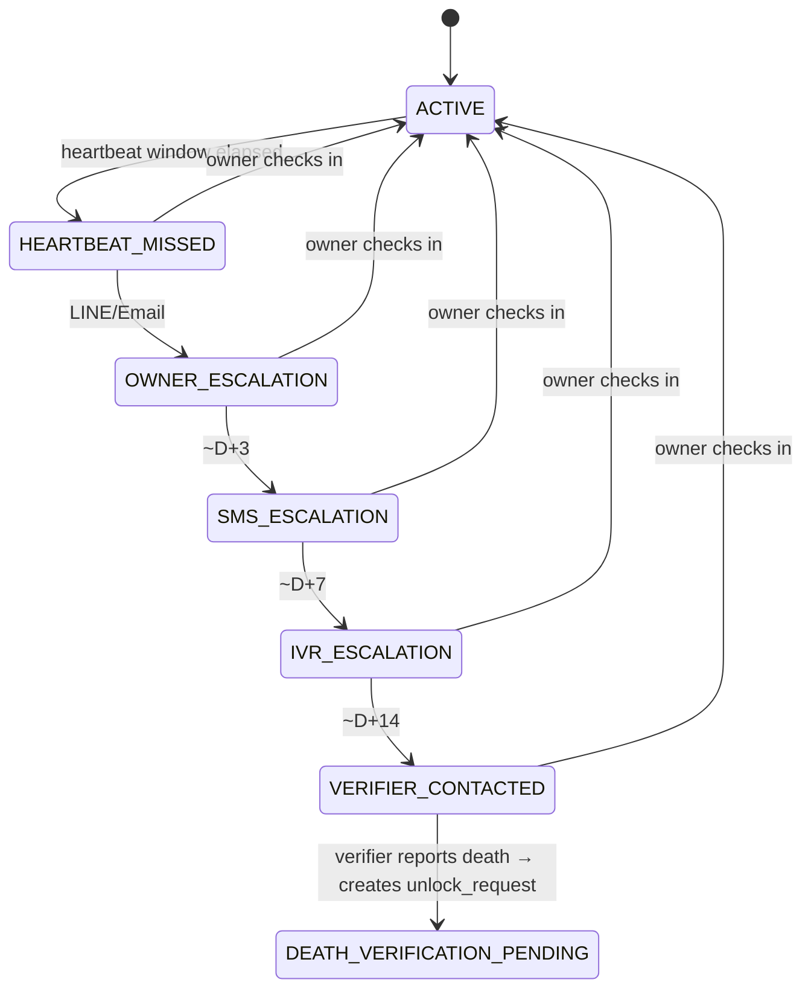
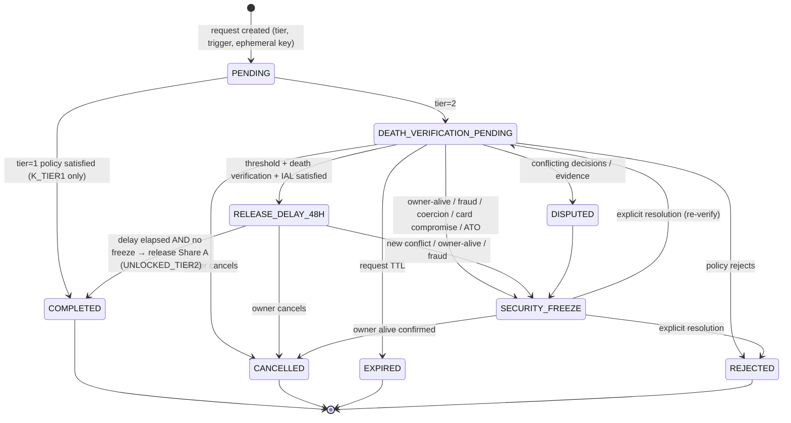
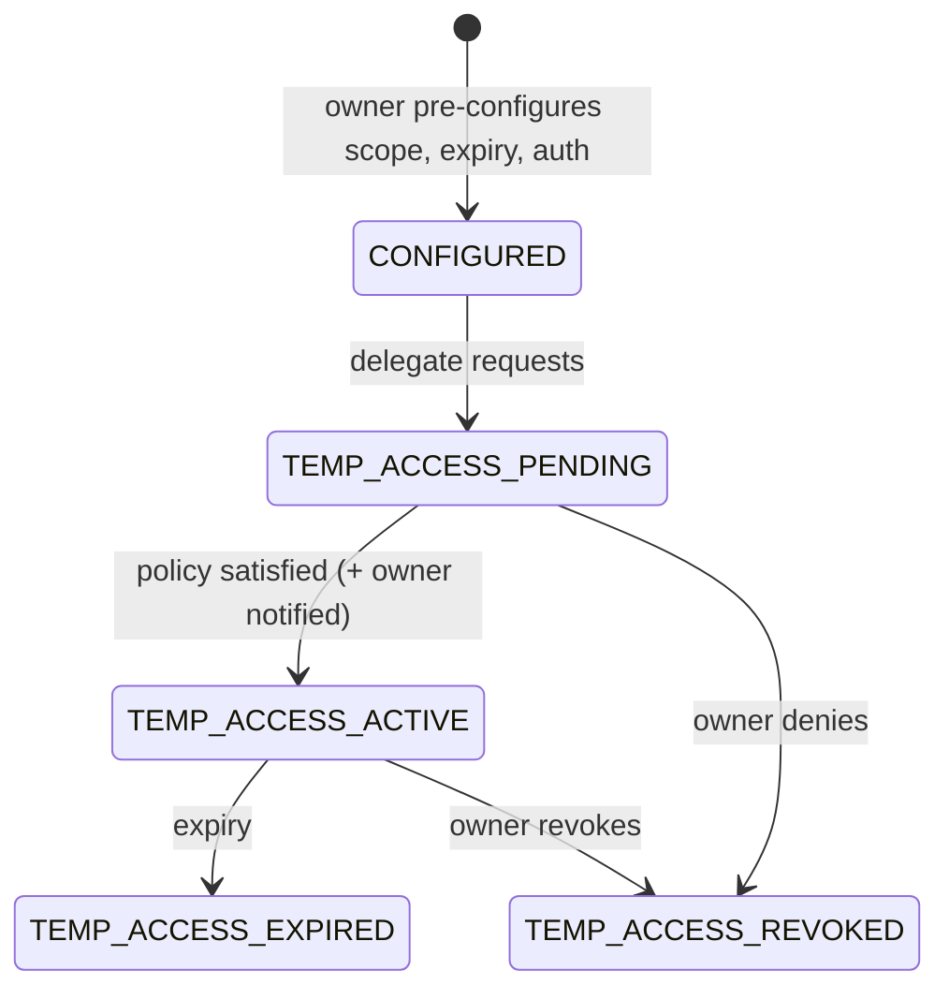

# State Machines

Derived from PRD §7, FR-4.1, FR-4.6, FR-4.7, FR-5.1, FR-5.2 and FR-3.2.

> **Design note:** PRD §7 draws a single "vault lifecycle" that mixes the **heartbeat
> lifecycle** of the vault with the **unlock request** lifecycle. They are split here
> into separate machines (see REVIEW-NOTES R-04). A vault can have one heartbeat state
> and *several* unlock requests at once, and competing requests must be correlated (FR-4.6).

**Tier 2 recovery gate:** every release path, including B+C after service sunset, must preserve death verification, owner cancellation, dispute/`SECURITY_FREEZE` handling and the configured delay. A timer alone is insufficient. The portable protocol that proves these conditions is an open Phase 0 gate (R-25); do not implement or ship a B+C fallback before it is reviewed.

## 1. Heartbeat / inactivity (per vault) — FR-4.1 Path A

**Invariant (INV-07):** no state in this machine releases recovery material. The furthest it
can go is *prompting* a verifier to open an unlock request, which then has to pass the full
Tier 2 policy. SMS/IVR states require an active Continuity Service entitlement. Without it,
escalation runs over Email/LINE only (FR-1.1).

## 2. Unlock request (per request) — FR-4.1 Path B, FR-4.3, FR-4.6

| Rule | Ref |
|---|---|
| `RELEASE_DELAY_48H` is entered only once the threshold is satisfied | §7.1 |
| `SECURITY_FREEZE` blocks release and pauses the delay. It **never** exits on a timer | FR-4.6, AC-15 |
| Exiting `SECURITY_FREEZE` needs an explicit resolution policy, evidence review and an audit event | FR-4.6 |
| Owner cancellation invalidates the server release token and share delivery for that request | FR-4.3 |
| A B+C sunset path may release only with an independently verifiable proof that death approval, cancellation, freeze/dispute policy and the configured delay were all satisfied; no usable Share A is included in the owner bundle | ADR-003, ADR-012, R-25 |
| Continuity entitlement expiry can stop paid notification channels, but does not interrupt an unlock request already in progress | ADR-007 |
| Approvals belong to one request and expire with it (`COMPLETED/CANCELLED/EXPIRED/REJECTED`) | FR-4.3, AC-03 |
| A card revoked after the request was created → policy: **proposed** to force re-verification and freeze if the card was reported compromised | §7.1 (open) |
| A second concurrent Tier 2 request for the same vault → correlate. Conflicting requesters → `DISPUTED` | FR-4.6 |

## 3. Temporary delegation — FR-4.7

It can't transition into, or count toward, any Tier 2 unlock (INV-15).

## 4. Physical card — FR-5.1

`ISSUED(gen n) → ACTIVE → {REVOKED | SUPERSEDED(by gen n+1) | LOST_REPORTED → REVOKED}`.
Reporting a card lost **recommends share/key rotation**. Disabling the URL alone isn't enough.

## 5. Verifier — FR-5.2

`INVITED → ACCEPTED → AUTH_SETUP → ACTIVE ⇄ REVALIDATION_DUE → {REVOKED | REPLACED}`.
Every transition is a security event. Replacing a verifier rotates their share generation.

## 6. Beneficiary status (HR hub) — FR-3.2

`PREFERENCE_ONLY → DOCUMENT_GENERATED → SUBMISSION_PENDING → SUBMITTED_TO_PROVIDER → CONFIRMED_BY_PROVIDER`.
The product never reports `CONFIRMED_BY_PROVIDER` unless the user records it or a provider confirms it.

## 7. Document provenance — FR-5.6

V1 supports `SELF_DECLARED | USER_UPLOADED`. Provider/official states require a defined evidence source,
verification procedure and freshness/expiry rule before they are added. A status must not be read as
stronger evidence than actually exists.
